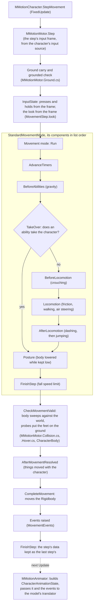
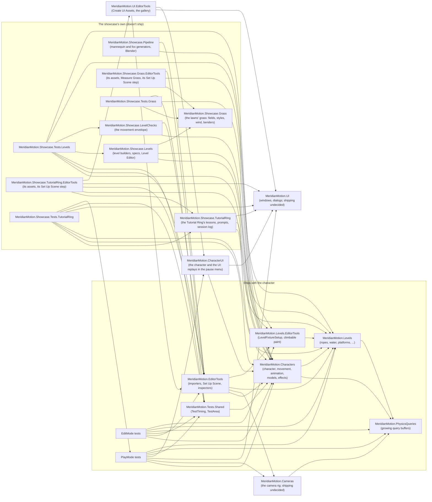

# Architecture
How the project fits together: what happens in one physics step, which code may know about which, and where each kind of thing lives. The rules for changing it are in AGENTS.md; this page is the map. Terms used here are in the [Glossary](glossary.md).

*See also:* [Troubleshooting](troubleshooting.md), [Unity Basics](unity-basics.md).

## The parts
The package is one folder, `Assets/MeridianMotion` (its code in Runtime/ and Editor/, its assets in Content/, its tests in Tests/); the showcase, which doesn't ship, is `Assets/Showcase`.
- **The character** (Assets/MeridianMotion/Runtime/Characters: Character/, Motor/, Body/):
  - `MMotionCharacter` drives it, and `CharacterSpawner` spawns it, and NPCs.
  - `MMotionMotor` moves it, resolving collision itself, with sweeps of its body rather than the physics solver.
  - Its body is a `CharacterBody`: a shape, not a collider (`PrimitiveBody`, shaped as one of Unity's primitive colliders is), held standing, low or lying.
  - The character has no collider: what meets it meets its model's hitboxes (`CharacterHitboxes`).
- **Input** (Assets/MeridianMotion/Runtime/Characters/Input, and its InputSources/): each physics step the character is given one input frame (`CharacterInputFrame`) by its input source: the player's device for the local player (`PlayerInputReader`, latching it into one frame a step with `InputLatch`), a script or an NPC's route for others. An `CharacterInputRecorder` records the frames, to be replayed (`InputRecording`). See [Input](movement.md#input) and [NPCs and input sources](spawning.md#npcs-and-input-sources).
- **The movement** (Assets/MeridianMotion/Runtime/Characters/MovementModes): a movement mode (`StandardMovementMode`, a ScriptableObject asset) made of movement components (walking and running, falling and air handling, and each ability), which the `MMotionMotor` runs every physics step. See [Movement](movement.md).
- **Animation, IK and models** (Assets/MeridianMotion/Runtime/Characters/Animation, IK, Models): `MMotionAnimator` turns what the movement did into an animation state for the model; `CharacterModelSlot` gets the model from a model source; IK components keep hands and feet on things. See [Character Model and Animations](animation.md).
- **Effects** (Assets/MeridianMotion/Runtime/Characters/Effects): `WaterEffects` plays splashes and ripples from the movement's events and state, as prefabs anyone can replace (see [Climbing and Traversal](traversal.md#splashes-and-ripples)).
- **The camera** (Assets/MeridianMotion/Runtime/Cameras): `MMotionCameraRig`, which follows any Transform. See [Camera System](camera.md).
- **The level elements** (Assets/MeridianMotion/Runtime/LevelElements, an assembly of their own): what the character traverses and the levels are equipped with (water and its underwater view, climbable and painted surfaces, ladders, ropes, ziplines, bounce pads, moving platforms, pushables, the course timer and timing gates, the level clock, stable IDs). Their editor assembly (Editor/) holds the climbable paint tool and `LevelFixtureSetup`, which turns a level's named fixtures into level elements. See [Climbing and Traversal](traversal.md) and [Test Levels](showcase/levels.md).
- **The level builders** (Assets/Showcase/Editor/Levels): editor tools that generate the showcase's graybox levels from pieces, recorded as level specs, and attach the level elements as they build. See [Test Levels](showcase/levels.md) and [Level Specs](showcase/level-specs.md).
- **The pipeline and the level checks** (Assets/Showcase/Editor/Pipeline, Assets/Showcase/Editor/LevelChecks): the mannequin's and the fox's generators, which run Blender (and only that: the fox is then prepared as any generic-rig character, by the shipped `GenericRigModelImporter`), and the movement envelope the level specs are checked against. Each is an editor assembly of its own, so the character can ship without them (AGENTS.md, The package line).

## One physics step
Movement runs in `FixedUpdate`; what's only seen (smoothing the model's turn, animation) runs in `Update`, from the last finished step.

What each part hands on:
- The mode fills in a `MovementStep` for the step: where the character means to go, how fast, which way it faces, and its `CharacterState` flags (grounded, jumping, wall running, ...).
- `CheckMovementValid` resolves that against the world, removing blocked momentum and recording which sides were blocked: the body (its parts lifted a step above the feet, hovering over steps) meets walls and ceilings, and probes under the feet put them on the ground (see [Collision](movement.md#collision)). What it did is recorded too (`MovementStep.resolution`), for seeing why the character moved as it did.
- The step's events (`MovementEvents`: jumped, landed, a ledge grabbed, ...) come from its flags changing between steps.
- Animation never reaches into the movement: it reads the last step's `MovementStep` and the events, and its translator sets the model's Animator.

## What may know about what
Each arrow is a reference between project assemblies that's allowed; anything else isn't (the hygiene check's `ALLOWED_REFERENCES` holds it, with the Unity packages each may use, and AGENTS.md's assembly table says the same: keep the three in step).

The character's code, the camera's and the UI's don't reference each other at all (both use `MeridianMotion.PhysicsQueries`, which references nothing: see [why](decisions.md#physics-query-buffers-are-their-own-assembly-and-grow-november-2026)). The character uses the level elements, which reference only `MeridianMotion.PhysicsQueries`; the level builders reference only the level elements. Only the character's editor tools and the tests reach both the character and the camera. The showcase's grass references nothing of the project's: the level builders add it, and Set Up Scene connects the characters to it (the spawner's events, to give each a Grass Bender), so it never names the character. Nothing that ships references what doesn't. (Of Unity's packages, the character's and the camera's assemblies use the Input System, and only the level builders use URP and TextMeshPro; the test assemblies also use Unity's test runner.)

The rules this follows are AGENTS.md's [Architectural rules](../AGENTS.md#architectural-rules-do-not-break-these), which are the ones to keep (this is a summary of them, kept in step):
- **The UI knows nothing about the character, the level or the camera.** It tells the game what its windows need (the pointer, the game's input stopped) through UnityEvents on its `UIManager`, which the scene connects to the camera's `CursorRequested` and `PlayerInputReader.Suppressed`.
- **The camera knows nothing about the character.** It follows a plain Transform, connected in the scene, not in code: Set Up Scene wires the spawner's On Camera Target Spawned event to `MMotionCameraRig.Follow`, which gets the character, its eye point and its size reference (see [Camera System](camera.md#connecting-it-to-something)).
- **The levels know nothing about the character or the camera.** The level elements are the level's, and the character uses them (the abilities find them, as with `MeridianMotion.Levels.SwingRope.All`). The builders make geometry, lighting and named fixtures and markers, and each build attaches the level elements to them (`LevelFixtureSetup`, whose names both sides use). Set Up Scene (`CharacterSceneSetup`) connects the character side: the spawner and its spawn points, the camera, the input manager, and who's racing the course timers.
- **Movement and animation are separate.** Movement code never touches Animators, models or IK; a model's own needs belong in its animation translator.
- **Models come from a model source.** `CharacterModelSlot` asks a `CharacterModelSource` for a model and gives it back; a new way of getting one is a new source.
- **The movement components know each other only through their mode**: shared rules (gravity, the jump press, whether an ability is under way), another component's settings (`SettingsOf<T>`), or handing the character over (`Mode.Get<T>`). See [Adding a Movement Ability](adding-an-ability.md).

## State and assets
- **Movement modes are shared assets.** Every character using a mode uses the same asset, so nothing about one character is kept on it: what each character is doing (its jumps left, a zipline it's riding) is kept on its `MMotionMotor`, in a state class for each ability.
- **The body moves; the hitboxes meet the world.** The movement's body is a shape it sweeps itself (`CharacterBody`), not a collider; the character has no collider of its own. What comes at it (a thrown ball, a trigger) meets its model's hitboxes (`CharacterHitboxes`, on the CharacterHitbox layer), which no movement or IK query meets. See [Collision](movement.md#collision) and [Hitboxes](animation.md#hitboxes).
- **Read the physics pose, not the Transform.** The character's Rigidbody is interpolated (and moving platforms interpolate themselves), so a Transform shows a pose between steps. Movement reads `Rigidbody.position` and `rotation`.
- **Moving ground moves first.** Each physics step a moving platform sets its new pose at once (where the level's clock, `LevelClock`, has it), before the characters step (`TickedPlatform.MoveOrder`), so a character rides it and queries it where it will be after the step ([why](decisions.md#moving-ground-moves-first-its-pose-set-at-once-november-2026)).
- **Movement has its own clock**, in whole steps: `MMotionMotor.InputTick` counts the steps taken, and is what the input frames are tagged with; `StepIndex` is the step under way (inside a step, one more than `InputTick`), and is what timing goes by (`SecondsSince`; `StepTime` is it in seconds), exact however long a character runs ([why](decisions.md#movement-keeps-time-in-ticks-november-2026)). A copy of the character can be stepped faster than real time: that's how its capabilities are measured (`MovementSimulation`), by running the real movement code.
- **Movement is deterministic on one build.** The same state, input frames and world give bit-identical steps: ties between equally good choices go by where things are (`StableOrder`), the level's moving parts go by the level's clock (`MeridianMotion.Levels.LevelClock`), and PhysX's Enhanced Determinism is on. A character's state can be saved and put back between steps (`MMotionMotor.SaveState`, with the level's ropes and pushables: `WorldStateSnapshot`), or written to bytes and read into a character on another machine in the same level (`StateSerializer`, naming the level's objects by `MeridianMotion.Levels.StableId`). Across machines a server corrects its clients ([why](decisions.md#deterministic-on-one-build-corrected-across-machines-november-2026)).
- **Generated assets are regenerated, not edited.** The mannequin, its Animator Controller, the model prefabs, the level scenes (with their level elements), the level specs and the movement envelope are all made by editor tools (the table in AGENTS.md, Generated assets).

## Where things live
| What | Where |
| --- | --- |
| The character, its controller, input and spawner | Assets/MeridianMotion/Runtime/Characters: Character/ (`MMotionCharacter`, `CharacterSpawner`, the states and events), Motor/ (`MMotionMotor` split by area: `.Body`, `.Ground`, `.Collision`, `.Hover`, `.Queries`, `.Capabilities`, `.State`; the step), Body/ (`CharacterBody`, `PrimitiveBody`, `BodyShape`, `BodyDefinition`), Input/ (`CharacterInputFrame`, `InputState`, `InputLatch`, `InputRecording`, `CharacterInputRecorder`, and InputSources/), Determinism/ (`WorldStateSnapshot`, `StateSerializer`, `StableOrder`) |
| The movement mode and its components | Assets/MeridianMotion/Runtime/Characters/MovementModes, and Components/ (each component with its state class) |
| The movement assets and the character's body | Assets/MeridianMotion/Content/Movement: StandardMovementMode.asset (the character's), Character Body.asset (the Character prefab's Body Definition); the fox's, Assets/Showcase/Movement/Fox Movement.asset |
| The growing physics query buffers | Assets/MeridianMotion/Runtime/PhysicsQueries (its own assembly) |
| Animation and its translators; IK; model sources and hitboxes | Assets/MeridianMotion/Runtime/Characters/Animation, IK, Models |
| The camera rig | Assets/MeridianMotion/Runtime/Cameras |
| The UI framework | Assets/MeridianMotion/Runtime/UI (its own assembly), its prefabs in Assets/MeridianMotion/Content/UI, and Assets/MeridianMotion/Editor/UI (Create UI Assets) |
| The level elements | Assets/MeridianMotion/Runtime/LevelElements (its own assembly), and Assets/MeridianMotion/Editor/LevelElements (`LevelFixtureSetup` and the fixtures' names, the climbable paint tool) |
| Importers, Set Up Scene, inspectors, finding the package's assets | Assets/MeridianMotion/Editor (Models/, Animation/, Scene/, Effects/, Movement/, Settings/) |
| The assets that ship (the prefabs, the mannequin, its animation, the water shaders) | Assets/MeridianMotion/Content |
| The showcase's content (levels, scenes, the fox, sample models, the CMU clips) | Assets/Showcase |
| The mannequin's and the fox's generators, and running Blender | Assets/Showcase/Editor/Pipeline (its own assembly: Mannequin/, GenericRigs/, Blender/) |
| The movement envelope's writer | Assets/Showcase/Editor/LevelChecks (its own assembly) |
| The level builders, pieces and Level Editor | Assets/Showcase/Editor/Levels |
| The lawns' grass (fields, styles, wind, benders, its shaders) | Assets/Showcase/Grass (its own assembly, knowing nothing of the game), Assets/Showcase/Editor/Grass (Create Grass Assets, Measure Grass, the benders in Set Up Scene), Assets/Showcase/Tests/Grass (see [the levels' Grass](showcase/levels.md#grass)) |
| Tests | Assets/MeridianMotion/Tests/EditMode, PlayMode; the showcase's, Assets/Showcase/Tests/Levels, HUD, TutorialRing and Grass (see [Automated Tests](testing.md)) |
| The hygiene check, the levelspec tool, the Blender scripts (the mannequin's, the fox's, what they share, the clip libraries') | Tools/CI, Tools/LevelSpec, Tools/Mannequin, Tools/Fox, Tools/Blender, Tools/Animation |

Why it's built this way is in [Design Decisions](decisions.md).
