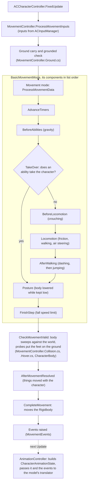
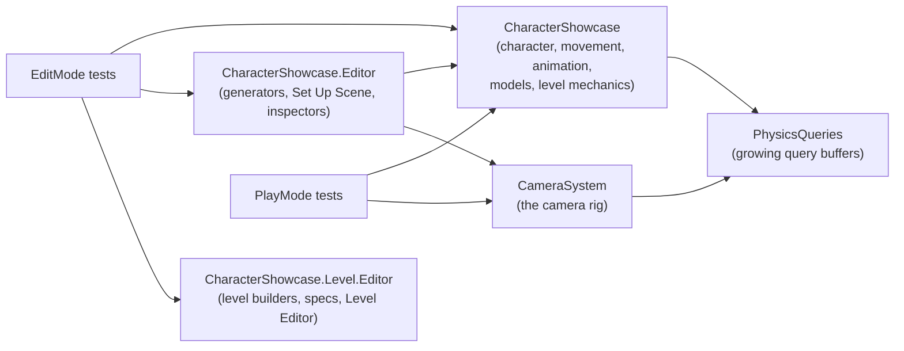

# Architecture
How the project fits together: what happens in one physics step, which code may know about which, and where each kind of thing lives. The rules for changing it are in AGENTS.md; this page is the map. Terms used here are in the [Glossary](glossary.md).

## The parts
- **The character** (Assets/Scripts/Character): `ACCharacterController` drives it; `MovementController` moves it, resolving collision itself with sweeps of its body (a `CharacterBody`: a shape, not a collider, as one of Unity's primitive colliders is, `PrimitiveBody`, held standing, low or lying; the character has no collider, and what meets it meets its model's hitboxes, `CharacterHitboxes`) rather than the physics solver; `ACInputManager` reads the player's input; `CharacterSpawner` spawns it.
- **The movement** (Assets/Scripts/MovementModes): a movement mode (`BasicMovementMode`, a ScriptableObject asset) made of movement components (walking and running, falling and air handling, and each ability), which the `MovementController` runs every physics step. See [Movement](movement.md).
- **Animation, IK and models** (Assets/Scripts/Animation, IK, Models): `AnimationController` turns what the movement did into an animation state for the model; `CharacterModelHost` gets the model from a model source; IK components keep hands and feet on things. See [Character Model and Animations](animation.md).
- **Effects** (Assets/Scripts/Effects): `WaterEffects` plays splashes and ripples from the movement's events and state, as prefabs anyone can replace (see [Climbing and Traversal](traversal.md#splashes-and-ripples)).
- **The camera** (Assets/Scripts/CameraSystem): `CameraRig`, which follows any Transform. See [Camera System](camera.md).
- **The levels** (Assets/Editor/Level, Assets/Scripts/Level): editor builders that generate graybox levels from pieces, recorded as level specs; and the runtime components of their mechanics (moving platforms, ropes, ziplines, bounce pads, water, climbable surfaces). See [Test Levels](levels.md) and [Level Specs](level-specs.md).

## One physics step
Movement runs in `FixedUpdate`; what's only seen (smoothing the model's turn, animation) runs in `Update`, from the last finished step.

What each part hands on:
- The mode fills in a `MovementData` for the step: where the character means to go, how fast, which way it faces, and its `CharacterState` flags (grounded, jumping, wall running, ...).
- `CheckMovementValid` resolves that against the world, removing blocked momentum and recording which sides were blocked: the body (its parts lifted a step above the feet, hovering over steps) meets walls and ceilings, and probes under the feet put them on the ground (see [Collision](movement.md#collision)). What it did is recorded too (`MovementData.resolution`), for seeing why the character moved as it did.
- The step's events (`MovementEvents`: jumped, landed, a ledge grabbed, ...) come from its flags changing between steps.
- Animation never reaches into the movement: it reads the last step's `MovementData` and the events, and its translator sets the model's Animator.

## What may know about what
Each arrow is a reference that's allowed; anything else isn't.

The character's code and the camera's don't reference each other at all (both use `PhysicsQueries`, which references nothing: the physics query buffers that grow when a query fills them, since Unity's results come in no order and a full buffer can leave out the nearest hit), and the level builders reference no project code; only the editor tools and the tests reach across. (Both runtime assemblies and the level builders use Unity's packages: the Input System, URP, TextMeshPro.)

- **The camera knows nothing about the character.** It follows a plain Transform. The two are connected in the scene, not in code: Set Up Scene wires the spawner's On Camera Target Spawned event to `CameraRig.Follow`, which gets the character, its eye point and its size reference (see [Camera System](camera.md#connecting-it-to-something)).
- **The levels know nothing about the character or the camera.** The level builders make geometry, lighting and named markers. (Their runtime mechanics, in Assets/Scripts/Level, are in the character's assembly, but know nothing about the character either: the abilities find them, as with `Level.Rope.All`.) Set Up Scene (`SceneGameSetup`, `LevelFixtureSetup`) turns the markers into working mechanics and spawn points from the character's side.
- **Movement and animation are separate.** Movement code never touches Animators, models or IK; a model's own needs belong in its animation translator.
- **Models come from a model source.** `CharacterModelHost` asks a `CharacterModelSource` for a model and gives it back; a new way of getting one is a new source.
- **The movement components know each other only through their mode**: shared rules (gravity, the jump press, whether an ability is under way), another component's settings (`SettingsOf<T>`), or handing the character over (`Mode.Get<T>`). See [Adding a Movement Ability](adding-an-ability.md).

## State and assets
- **Movement modes are shared assets.** Every character using a mode uses the same asset, so nothing about one character is kept on it: what each character is doing (its jumps left, a zipline it's riding) is kept on its `MovementController`, in a state class for each ability.
- **The body moves; the hitboxes meet the world.** The movement's body is a shape it sweeps itself (`CharacterBody`), not a collider; the character has no collider of its own. What comes at it (a thrown ball, a trigger) meets its model's hitboxes (`CharacterHitboxes`, on the CharacterHitbox layer), which no movement or IK query meets. See [Collision](movement.md#collision) and [Hitboxes](animation.md#hitboxes).
- **Read the physics pose, not the Transform.** The character's Rigidbody is interpolated (and moving platforms interpolate themselves), so a Transform shows a pose between steps. Movement reads `Rigidbody.position` and `rotation`.
- **Moving ground moves first.** Each physics step a moving platform sets its new pose at once, before the characters step (`MovingPlatform.MoveOrder`), so a character rides it and queries it where it will be after the step. Moved by `MovePosition`, which only takes effect at the physics step, it was read a step late and ridden a step behind.
- **Movement has its own clock** (`MovementController.StepTime`), so a copy of the character can be stepped faster than real time: that's how its capabilities are measured (`MovementSimulation`), by running the real movement code.
- **Generated assets are regenerated, not edited.** The mannequin, its Animator Controller, the model prefabs, the level scenes, the level specs and the movement envelope are all made by editor tools (the table in AGENTS.md, Generated assets).

## Where things live
| What | Where |
| --- | --- |
| The character, its controller, input and spawner | Assets/Scripts/Character (`MovementController` split by area: `.Body`, `.Ground`, `.Collision`, `.Hover`, `.Queries`, `.Capabilities`); the body (`CharacterBody`, `PrimitiveBody`, `BodyShape`, `BodyDefinition`) |
| The movement mode and its components | Assets/Scripts/MovementModes, and Components/ (each component with its state class) |
| The movement asset | Assets/ScriptableObjects/BasicMovementMode.asset |
| Animation and its translators; IK; model sources and hitboxes | Assets/Scripts/Animation, IK, Models |
| The camera rig | Assets/Scripts/CameraSystem |
| The level mechanics at runtime | Assets/Scripts/Level |
| Generators, importers, Set Up Scene, inspectors | Assets/Editor |
| The level builders, pieces and Level Editor | Assets/Editor/Level |
| Tests | Assets/Tests/EditMode, PlayMode (see [Automated Tests](testing.md)) |
| The hygiene check, the levelspec tool, the Blender scripts (the mannequin's, the fox's, the clip libraries') | Tools/CI, Tools/LevelSpec, Tools/Mannequin, Tools/Fox, Tools/Animation |

Why it's built this way is in [Design Decisions](decisions.md).
