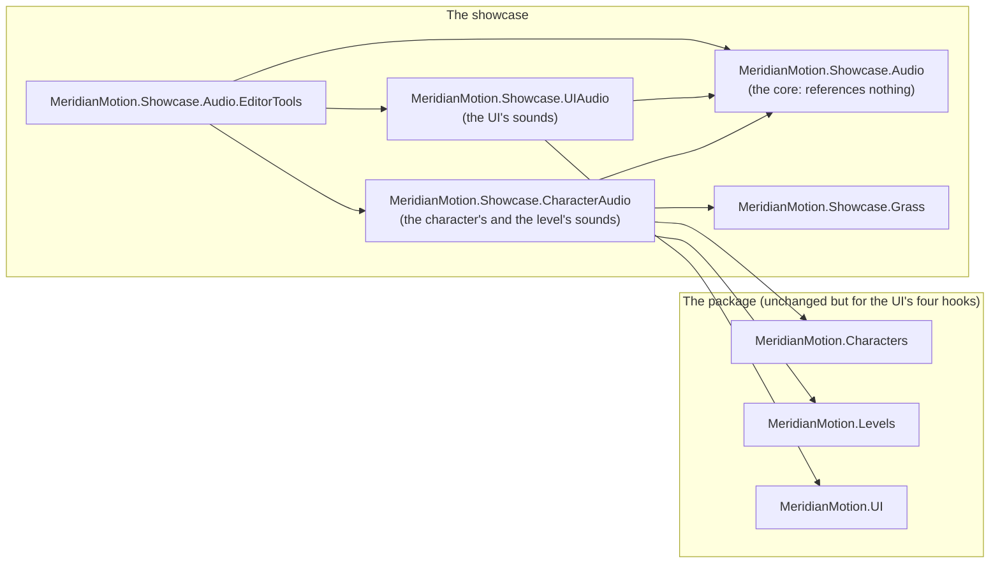

# Audio

The showcase's music and sounds: a looping track per level, the character's sounds as it moves through the level, the
level's own (checkpoints, gates, the course timer) and the UI's. It's the showcase's, not the package's
(`Assets/Showcase`): nothing that ships knows it's there. Its core knows nothing of Meridian Motion at all, so it could
become a package of its own.

The character's sound effects are generated (see [The generated sounds](#the-generated-sounds)); the rest are slots
waiting for clips, silent until they're given some: drop clips into a Sound Event (`Assets/Showcase/Audio/Sounds/...`)
or a Music Track (`Assets/Showcase/Audio/Music`).

## The parts



- **The core** (`Assets/Showcase/Audio`): everything played is a `SoundRequest` (which sound, by its id; where; how
  strong; who made it), handed to the scene's `AudioService`. It runs the request through its filters
  (`ISoundFilter`: rules over every sound), drops a 3D sound farther than its Max Distance from the listener, holds the
  sound to its Max Instances and Cooldown, and plays it on one of a fixed pool of voices (the service's Voice Count):
  when they're all busy, the oldest of the lowest-priority sounds gives way to one of higher priority (never to an equal one). Nothing is
  allocated per sound. Loops are stopped, moved and made louder or quieter through the handle `Play` returns.
  - A `SoundEvent` is one kind of sound: its clip variations, its volume and pitch ranges, its bus, 2D or 3D, whether it
    loops, its limits and its priority. Every number a designer tunes about a sound is there.
  - An `AudioBus` is a group of sounds with one volume (Music, Effects, UI), saved for the player
    (`AudioService.SetVolume`, in PlayerPrefs under the service's Volume Key Prefix). While the game is paused, buses
    marked Pauses With Game pause and go on where they were; music and the UI play on.
  - The `SoundLibrary` lists every Sound Event, so a request's id finds its sound. Its inspector's Find Every Sound Event
    adds them all and gives each new one (or a duplicate, which kept its original's) an id after the highest ever given;
    a new Sound Event gets one by itself. Ids are never changed or reused.
  - The `MusicPlayer` (beside the service) plays one `MusicTrack` at a time: its intro once, then its loop, scheduled to
    the sample so there's no gap, crossfading from one track to the next. A scene's `SceneMusic` asks for its track.
  - A `SoundEmitter` puts a sound on a scene object (a fountain, a machine): played on enable or by a UnityEvent; a loop
    follows the object.
- **The character's sounds** (`Assets/Showcase/CharacterAudio`): `CharacterSounds`, on each character, turns what its
  movement reports into requests. Its `CharacterSoundSet` says what it sounds like:
  - *event rows*: a movement event (by its flag's name, chosen from a list) and its sound, or the sound for the surface
    under the character; its strength from how fast it was falling or going (Strength From, Full Strength Speed). Rows
    for the same event with different Min Speeds split it (Land and Land (Hard));
  - *loop rows*: a state and the sound looped while the character's in it (Only While Moving, for climbing);
  - *footsteps*: a step as each of the model's feet comes down, as its foot IK says (`HumanoidFootPlacementIK.Planted`,
    `LegPlacementIK.Planted` for a generic rig's paws: lifted, then planted again), so they're in step with the
    animation; without a model's feet to follow, a cadence by speed (Walk Cadence at the movement's Walk Speed to Run
    Cadence at its Run Speed, on Walking And Running). Checked on the movement's own steps, so frame rate doesn't change
    them. Louder from walking to running, a sound per surface, and none in a state with its own sound (sliding,
    climbing, swimming...) or slower than Min Speed;
  - the splash (from the Water Effects' Splashed) and, for the player's character only (the director says which it is),
    the wind as it falls faster than Wind Speed: it's heard the same wherever it is, so an NPC's would sound like the
    player's.
  A character's sounds are higher the smaller it is. It reads the motor, not the animator, so it works without a model.
- **Surfaces**: the `SurfaceMap` (`Assets/Showcase/Audio/Surfaces/Surface Map.asset`) says which surface each level
  material is. The surface under the character is, in order: a `SurfaceTag` on the ground or above it; grass, if the
  grass says there's at least the map's Grass Cover under the feet (`GrassField.CoverAt`: lawns have no collider of
  their own); the ground's renderer's material (on it or above it: the graybox keeps its colliders on children without
  renderers); else the map's Fallback.
- **Who gets which sounds**: the package's Character prefab can't hold the showcase's components, so the scene's
  `CharacterAudioDirector` adds `CharacterSounds` to each character the spawner spawns (its On Character Spawned and
  On Npc Spawned), with the set for its prefab by name (By Prefab: the fox's), else the Default Set.
- **The level's sounds**: `LevelSounds` plays its `LevelSoundSet` from the level elements' events: the player reaching a
  checkpoint or respawning (an NPC doesn't), a shortcut gate opening, the course timer's splits and finishes.
- **The UI's sounds** (`Assets/Showcase/UIAudio`): `UISounds` listens to the UI framework's generic hooks (a window
  opening or closing, Back, a notification: [the UI's hooks](../ui.md#how-it-meets-the-game)) and gives each window's
  controls a `UISoundRelay` for their hover, click, denied (a greyed-out control), toggle, slider and tab sounds, from its
  `UISoundSet` (again a frame after the window opens, for the rows its lists make as they start). Only windows the
  player uses (those that need the cursor) make the open and close sounds, not name tags or HUD prompts, and a toggle
  plays only when a person changes it, not code.

Nothing in the audio writes to the game: a test runs the same course with and without the character's sounds and
holds the movement the same to the bit (`AudioReadsOnlyTests`).

## Setting it up

Tools > Meridian Motion > Showcase > Create Audio Assets (`AudioAssets.CreateFromCommandLine` for `-executeMethod`)
makes what's missing in `Assets/Showcase/Audio`: the buses, the surfaces and the Surface Map, an empty Sound Event for
every sound below, the sound sets pointing at them, a Music Track per showcase scene, the Sound Library and
`Audio.prefab` (the service and the music player). Then they're hand-edited; running it again changes nothing.

Set Up Scene adds the audio to the showcase's scenes (`AudioSceneSetup`, through `CharacterSceneSetup.AfterSettingUp`):
the Audio prefab, and an Audio object with the director (connected to the spawner), the Level Sounds, the UI Sounds and
the scene's Scene Music (its track by the scene's name, `AudioAssets.SceneTracks`).

## The sounds

What Create Audio Assets makes, each a Sound Event in `Assets/Showcase/Audio/Sounds` (the rows and their
settings are on the sets, which are where to retune them):

- **Music** (`Music/`): a track for each of the Level Playground, the Meridian Complex, the Meridian Basin and the
  Tutorial Ring.
- **The character's one-shots** (`Sounds/Character`, rows of the Mannequin and Fox Sound Sets): Jump, Air Jump, Wall
  Jump, Land, Land (Hard), Dash, Hit Wall, Hit Ceiling, Slide Start, Roll, Crouch, Stand, Ledge Grab, Ledge Climb, Ledge
  Drop, Grab, Vault, Step Up, Wall Run Start, Wall Climb Start, Rope Grab, Rope Release, Zipline Attach, Zipline Detach,
  Bounce, Dive, Surface and Splash. Jump, Land, Land (Hard), Hit Wall, Slide Start, Roll and Step Up have one per surface
  ("Land (Metal)"), as do the footsteps (Footstep, Footstep (Crouched)).
- **The character's loops**: Slide, Wall Run, Wall Slide, Climb, Rope Creak, Zipline, Swim, Wade, Underwater and Wind.
- **Surfaces** (`Surfaces/`): Concrete (the fallback), Metal, Glass, Soil, Grass and Foliage, mapped from the
  `Level_[Surface].mat` materials and their (Moving) variants.
- **The level's** (`Sounds/Level`, the Level Sound Set): Checkpoint Reached, Respawn, Shortcut Gate Opened, Course
  Split, Course Finished.
- **The UI's** (`Sounds/UI`, the UI Sound Set): Hover, Click, Denied, Toggle On, Toggle Off, Slider, Tab, Window Open,
  Window Close, Back, Notification.

## The generated sounds

The character's sound effects are synthesized from noise and sine waves by `Tools/Audio/make_sfx.py` (pure Python,
nothing to install or license), into `Assets/Showcase/Audio/Clips`:

```
python3 Tools/Audio/make_sfx.py --out Assets/Showcase/Audio/Clips     # what's missing; -f to remake, --seed N for new variations
```

Then Tools > Meridian Motion > Showcase > Assign Generated Clips (`AudioAssets.AssignClipsFromCommandLine`; Create
Audio Assets runs it too) puts each sound's variations on its Sound Event, with the generator's pitch and volume ranges
(its levels are balanced against each other, so the Sound Events share one volume). It fills only Sound Events with no
clips, so clips put on by hand stay; to take a regenerated set, clear the Sound Event's clips first. The script's
`--list` names its sounds; `AudioAssets.Clips.cs` says which Sound Event each goes on.

The generator makes concrete, metal and grass: Glass takes concrete's, Soil and Foliage grass's. It makes the
character's one-shots, the splash, the dive and surfacing, and the slide, wall run and zipline loops; the other loops
(wall slide, climb, rope creak, swim, wade, underwater, wind), the level's and the UI's sounds, and the music are still
empty slots. It also makes a few the sets have no row for yet: a slide's end and a wall run's end (`SlideEnded`,
`WallRunEnded` rows would play them) and a dash in the air.

## Adding to it

| To add | Do |
| --- | --- |
| A sound for something the character does | Make a Sound Event (Create > Meridian Motion > Audio > Sound Event) and add a row for its movement event or state to the character's Sound Set |
| A sound on a new surface | Make a Sound Surface, map its material in the Surface Map (or put a Surface Tag on the object), and add the surface's rows |
| A sound on a level piece | Put a Sound Emitter on it |
| Music for a scene | Make a Music Track and put Scene Music in the scene (or add the scene to `AudioAssets.SceneTracks` for Set Up Scene) |
| A new kind of thing that makes sound (a machine's events) | A small listener, like `LevelSounds`, that turns its events into `SoundRequest`s |
| A rule over every sound (muting others, netcode's) | An `ISoundFilter`, added to the service (`AddFilter`) |
| A volume slider | `AudioService.SetVolume(bus, value)`: it's saved |

## Netcode, later

Nothing goes over a network yet, and nothing needs to for the characters' sounds:

- **They're derived, not sent.** A remote character is stepped from the state its owner sends, so it raises the same
  events, and makes the same sounds, on every machine. Sending them would double them.
- **Rolling back re-runs steps,** and so re-raises their events: a filter (`ISoundFilter`) that says no while the
  netcode resimulates is where that goes. Every request passes the filters, so it's one place.
- **A sound that can't be derived** (a server's: someone scored) is a `SoundRequest`, an unmanaged value of ids and
  numbers, which can be sent as it is and played on the other side. `SoundFlags.LocalOnly` marks one never to send.
- **`EmitterId`** says who made a sound, so a rule can treat the local player's own differently from others'.
- **The audio never writes to the game**, and its random choices are its own (`System.Random`), so it can't disturb
  anything that's kept the same on every machine.

## Its tests

`MeridianMotion.Showcase.Tests.Audio` (PlayMode, `python3 Tools/run_tests.py --area Audio`): the service and its pool,
volumes, music, emitters, surfaces, the character's sounds and footsteps on the test rig, the director and the level's
sounds, the UI's, that the audio leaves the movement alone, and what Create Audio Assets and Set Up Scene make. The
service and the music player keep their own timing (when a sound ends, a fade, a pause), so the tests read their state:
audio doesn't play in batch mode.
