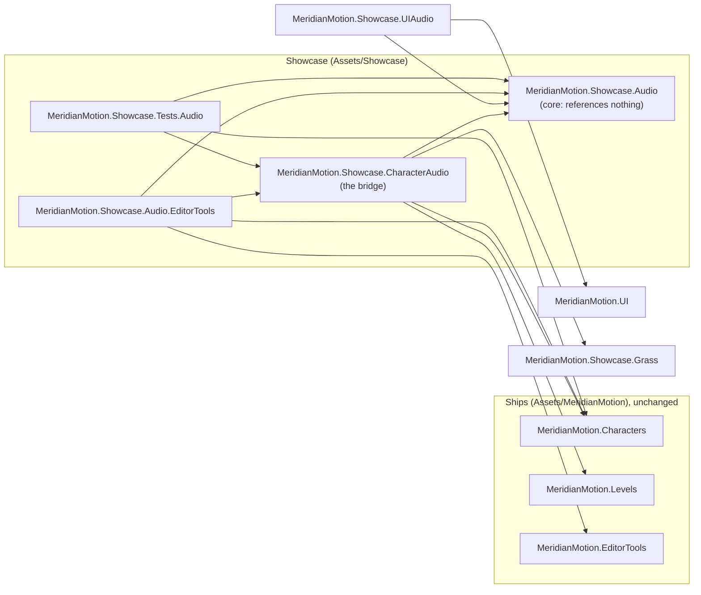
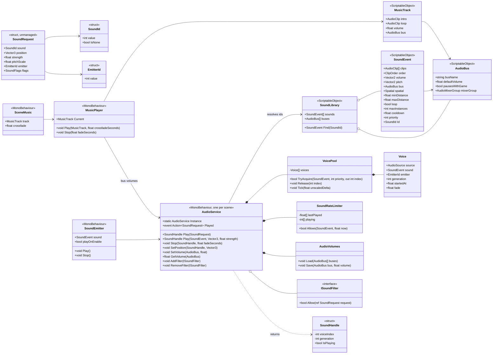
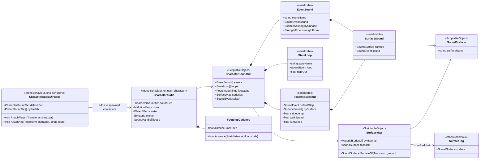
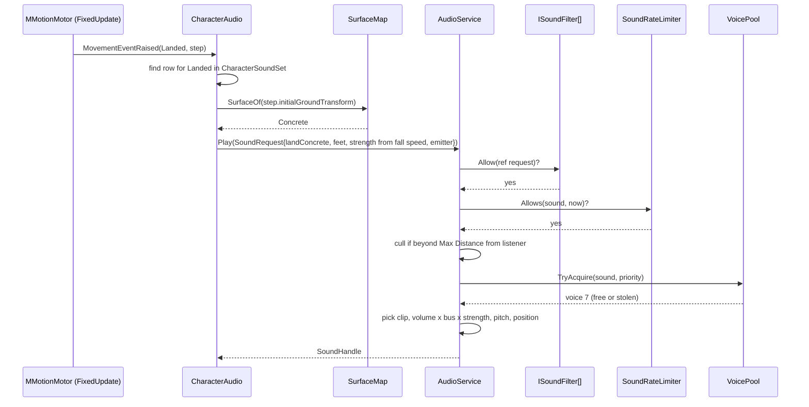
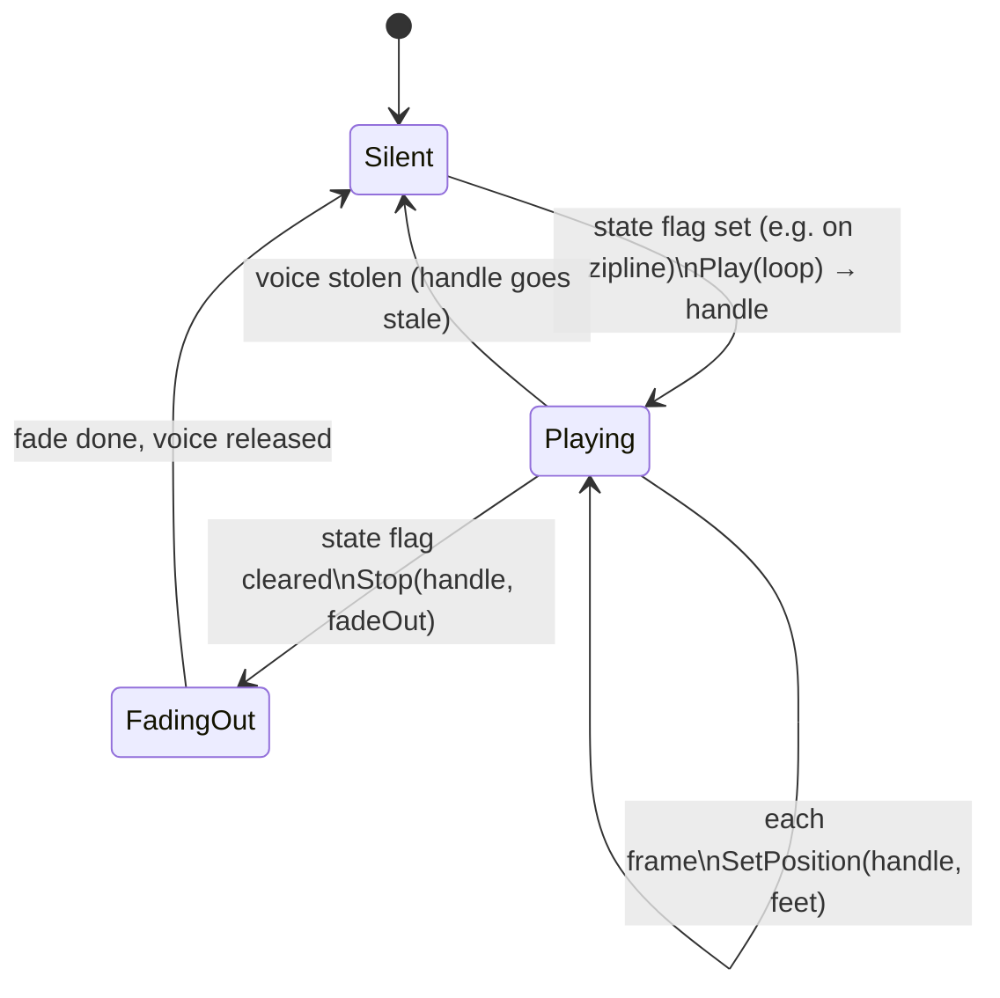
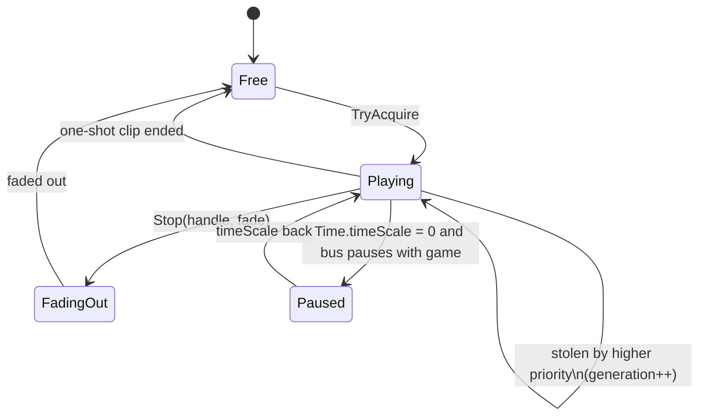
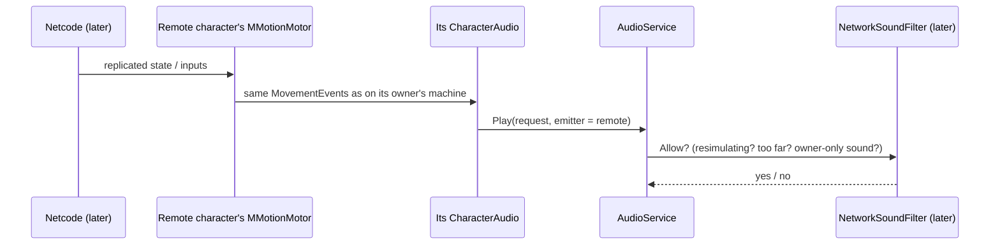

# Audio system: design

Date: 2026-11-25. Status: draft, for approval.

## Why

Playtesters are going through the showcase now, and it is silent. It needs looping music, and sounds for what the
character does in the level: footsteps, landings, splashes, grabbing ledges and ropes, ziplines. The same system is meant
to be what the full game builds on (a multiplayer variant, Netcode for GameObjects), and possibly a standalone package
of its own later. So it has to be small enough to ship for the playtest, and shaped so the game can grow it without
rewriting it.

## Goals

- Music that loops, set per scene, with crossfades when it changes.
- Sound effects for the character's interactions with the environment, driven by what the movement already reports
  (`MovementEvents`, `CharacterState`, `WaterEffects.Splashed`), varied by the surface underfoot.
- Performant: no allocation per sound, a fixed pool of voices, limits on how many of a sound play at once, nothing
  started that's too far away to hear.
- Easy to add to: a new sound is an asset and a table row, not code. A new *kind* of thing that makes sound is one small
  listener class.
- Easy to understand: one entry point (`AudioService.Play`), one value that describes a sound (`SoundRequest`).
- Friendly to netcode later: every sound is a plain value that could be sent, and the rule for who hears what is in
  one place.

## Non-goals (for this version)

- Volume sliders on the pause menu. The design makes room for them (bus volumes, saved), but the UI page is later.
- Ambience zones, adaptive or layered music, reverb zones, dialogue.
- Anything over the network. This version only makes sure nothing stands in the way.
- Audio middleware (FMOD, Wwise).

## Anti-goals (it fails if...)

- ...the movement, the level elements, the UI or the camera have to know about audio. Audio listens; nothing calls it
  from the core.
- ...the audio core references anything of Meridian Motion's. It must lift out as its own package.
- ...sounds can change the movement (determinism, `DeterminismTests`, `GoldenPathTests` must not notice it exists).
- ...adding the hundredth sound is harder than adding the first.

## Constraints

- Not in the package: everything lives in `Assets/Showcase` (AGENTS.md, The package line). Nothing that ships may
  reference it.
- The package's prefabs (`Character.prefab`, `Camera Rig.prefab`) can't hold showcase components, so audio is attached
  to characters at runtime and added to scenes by Set Up Scene's hook (`CharacterSceneSetup.AfterSettingUp`), as the
  UI and the grass benders are.
- The movement runs in `FixedUpdate` and raises its events there; audio plays in `Update`-side code. A movement event
  is turned into a request at once (cheap) and played the same frame.
- The game pauses by `Time.timeScale = 0` (`PauseMenu`). Music keeps playing while paused; effects pause.
- AGENTS.md's rules: `[Tooltip]` on every serialized field, `[AddComponentMenu("Meridian Motion/Audio/...")]`, Create
  menus under "Meridian Motion/Audio/", tools under Tools > Meridian Motion > Showcase, every new assembly in AGENTS.md's
  table and the hygiene check's `ALLOWED_REFERENCES`, docs that name where a value lives rather than quoting it.
- No package changes (`Packages/manifest.json`): Unity's built-in audio only.

## Approaches considered

| | Approach | Trade-off | Verdict |
| --- | --- | --- | --- |
| **A** | Sound events (assets) played by one pooled audio service; a separate bridge maps the character's events to them | The most structure up front (about a dozen small classes) | **Chosen** |
| B | AudioSources on prefabs, wired with UnityEvents | Fast to start; wiring scattered across prefabs and scenes, no pooling or voice limits, no single seam for netcode | Rejected |
| C | Middleware (FMOD/Wwise) | Powerful mixing; a package change, licensing, and a dependency a standalone package would carry | Rejected: far more than looping music and effects need |

Chosen by the user: A.

## The design

### Assemblies



| Assembly | Folder | May reference |
| --- | --- | --- |
| `MeridianMotion.Showcase.Audio` | `Assets/Showcase/Audio` | nothing (the core: knows nothing of the character, the level, the UI or the camera) |
| `MeridianMotion.Showcase.CharacterAudio` | `Assets/Showcase/CharacterAudio` | MeridianMotion.Showcase.Audio, MeridianMotion.Characters, MeridianMotion.Levels, MeridianMotion.Showcase.Grass **only** (the grass: whether there's grass underfoot) |
| `MeridianMotion.Showcase.UIAudio` | `Assets/Showcase/UIAudio` | MeridianMotion.Showcase.Audio, MeridianMotion.UI, UnityEngine.UI **only** (the UI's sounds) |
| `MeridianMotion.Showcase.Audio.EditorTools` | `Assets/Showcase/Editor/Audio` | MeridianMotion.Showcase.Audio, MeridianMotion.Showcase.CharacterAudio, MeridianMotion.Showcase.UIAudio, MeridianMotion.UI, MeridianMotion.EditorTools, MeridianMotion.Characters |
| `MeridianMotion.Showcase.Tests.Audio` | `Assets/Showcase/Tests/Audio` | MeridianMotion.Showcase.Audio, MeridianMotion.Showcase.CharacterAudio, MeridianMotion.Showcase.UIAudio, MeridianMotion.UI, MeridianMotion.Showcase.Grass, MeridianMotion.Characters, MeridianMotion.Levels, MeridianMotion.Tests.Shared, MeridianMotion.Tests.PlayMode (the rig) |

The core is the part that could become a package: lifting it out means renaming its namespace and moving its folder.
The bridge is this game's.

### The core (`MeridianMotion.Showcase.Audio`)



What each part is for:

- **`SoundEvent`** (asset, Create > Meridian Motion > Audio > Sound Event): one *kind* of sound. It holds its clip
  variations (picked at random, without repeating the last one, or in order), the volume and pitch range, its bus, 2D or
  3D and its distances, whether it loops, how many may play at once, the shortest gap between two of it, and its priority
  for when the pool is full. Every number a designer tunes is here, with a `[Tooltip]`.
- **`SoundId`**: a stable number for a `SoundEvent`, so a request is a plain value with no object reference (what makes
  it sendable later). It is assigned by the library and saved on the asset; it never changes once given.
- **`SoundRequest`**: one sound to play, as an unmanaged struct: which sound, where, how strong (0 to 1, scaling volume),
  a pitch scale (for small or large characters), who made it (`EmitterId`), and flags (`Follow`, `LocalOnly`, ...).
  Everything goes through this, which keeps the netcode seam in one place.
- **`AudioService`**: the one entry point, one per scene. `Play` runs the request through the filters, the rate
  limiter and a distance cull (a 3D sound beyond its Max Distance from the listener isn't started), takes a voice from the
  pool, sets it up and plays it. It returns a `SoundHandle` for loops (stopping them, moving them); one-shots can ignore it.
  It pauses the buses marked Pauses With Game while `Time.timeScale` is 0, and fades by unscaled time.
- **`VoicePool`**: a fixed array of `AudioSource`s made when the service wakes (Voice Count on the service). When it's
  full, a new sound takes the voice of the lowest-priority, oldest sound, if it has a higher priority; else it isn't played.
  No `AudioSource` is ever created or destroyed while playing.
- **`SoundHandle`**: an index and a generation, so a handle to a voice that's since been reused does nothing (no stale
  references, no allocation).
- **`AudioBus`** (asset): a group of sounds with one volume: Music, Effects, UI (and later Ambience). The bus multiplies
  its volume into its voices' in code, so no Audio Mixer is needed; a bus may also name an `AudioMixerGroup` to route
  through, for effects someone adds later.
- **`AudioVolumes`**: the buses' volumes, saved in `PlayerPrefs` under one key per bus. Ready for the pause menu's sliders.
- **`ISoundFilter`**: a rule that can veto or change a request before it plays. The netcode rules go here later (see
  Netcode). No filters exist in this version, but the hook does.
- **`SoundLibrary`** (asset): every `SoundEvent` and bus, so ids resolve to assets. The service is given one.
- **`MusicPlayer`**: two `AudioSource`s it crossfades between. A `MusicTrack` with an intro plays the intro once and
  then loops the loop clip, scheduled sample-exactly (`AudioSource.PlayScheduled`); without one, it just loops.
- **`SceneMusic`**: put in a scene, it asks the music player for its track when the scene starts.
- **`SoundEmitter`**: a sound on a scene object, played on enable or by a UnityEvent: the way a level piece that
  isn't the character makes sound (a fountain, a machine), without code.

### The bridge (`MeridianMotion.Showcase.CharacterAudio`)



- **`CharacterAudio`**: on each character. It listens to the motor's `MovementEventRaised` (events with the step, so the
  ground it's on) and the `WaterEffects`' `Splashed`, and reads the motor each frame (`lastStep`: its state and
  velocity; `groundTransform`) for footsteps and loops. It reads the motor, not the animator, so it works with no model
  or animation (the test rig, a server). It turns each into a `SoundRequest` with its own `EmitterId` and pitch scaled by the character's
  size, and hands it to the `AudioService`. It never plays anything itself.
- **`CharacterSoundSet`** (asset): the table of what the character sounds like. Rows name their event or state by its
  flag's name (`"Landed"`, `"Ziplining"`), read once with `MovementEvents.TryParse` / `CharacterState.TryParse`, so a
  project's own flags work too and the inspector is a dropdown of `Named`; a name that doesn't parse is warned about
  once. Each row says "this movement event plays
  this sound (or this one on that surface)" or "while in this state, loop this sound". A new sound for a new ability is
  a row here. The mannequin and the fox each get a set.
- **Footsteps**: the movement has no footstep event, so the bridge counts distance on the ground and steps every stride
  (`FootstepCadence`, the same idea as the camera's walk bob), its stride on the set and scaled by the character's size.
  Strength rises from walk to run speed. This is the bridge's own; the movement isn't changed.
- **Surfaces**: `SurfaceMap` finds the surface under the character from the ground's `Transform`: for an event, the
  step's `initialGroundTransform` (on the step that raises Landed, the ground just landed on; `finalGroundTransform` is
  never filled in); for footsteps and loops, the motor's `groundTransform`. It looks for a `SurfaceTag` on the ground or
  its parents first, else the first `Renderer` on it or its parents (graybox solids keep their colliders on child
  "Collider" objects with no renderer) and that renderer's first material, else the fallback. The map lists the
  `Level_[Surface].mat` materials and their `(Moving)` variants. The answer is cached per `Transform`, so it's looked up
  once per piece of ground, not per step.
- **Grass**: lawns have no collider, so the ground under a lawn is the floor beneath it. Before the map, the bridge asks
  the grass whether there's grass under the feet: a new, small, CPU-side query on the grass assembly,
  `GrassField.CoverAt(Vector3 position)` (0 to 1, read from the density mask the field already keeps on the CPU,
  `Layer.density`, at the nearest layer at or below the feet; static over the live fields). Above the Sound Set's Grass
  Cover threshold, the surface is the map's Grass surface. It's a lookup in a byte array, so it's cheap enough per
  footstep. The grass doesn't learn about audio: the query is general (anything could ask it).
- **`CharacterAudioDirector`**: in each scene (added by Set Up Scene). The package's Character prefab can't hold showcase
  components, so the director adds `CharacterAudio` to every character the spawner spawns: Set Up Scene connects the
  spawner's On Character Spawned to its `AttachPlayer(Transform)` and On Npc Spawned to its `AttachNpc(Transform,
  string)`, as `GrassSceneSetup` does for the grass benders. It chooses the set by prefab name, else the default.

### A sound, from the movement to the speaker



### Looping sounds tied to a state



### A voice's life



### Music

```mermaid
sequenceDiagram
    participant SM as SceneMusic
    participant MP as MusicPlayer
    participant A as AudioSource A
    participant B as AudioSource B
    SM->>MP: Play(Basin Theme, crossfade)
    MP->>A: intro: Play(); loop: PlayScheduled(dspTime + intro length)
    Note over MP,A: later, another scene or trigger
    SM->>MP: Play(Ring Theme, crossfade)
    MP->>B: start Ring Theme at volume 0
    MP->>A: fade out (unscaled time)
    MP->>B: fade in
    MP->>A: Stop when silent
```

The `MusicPlayer` lives on the same object as the `AudioService`, one per scene (the showcase's only scene load is the
pause menu's Restart, which starts the music again). Crossfades are for changing track within a scene; carrying music
across scene loads is left for the full game.

### Netcode, later

Nothing in this version touches the network, and nothing needs to be sent for the character's sounds:



- **Character sounds are derived, not sent.** A remote character is stepped from replicated state, so it raises the same
  events and makes the same sounds on every machine. Sending sounds would double them.
- **Rollback re-runs steps**, which re-raises their events. A later `ISoundFilter` drops requests made while the netcode
  resimulates (and could use the request's tick to play a missed sound late, or not at all). That's why every request goes
  through the filters.
- **Sounds that can't be derived** (a server-only event: someone scored, a door a remote player opened) are a
  `SoundRequest`, an unmanaged struct of ids and numbers: a later `NetworkSoundRelay` sends it as it is and calls `Play` on
  the other side. `SoundFlags.LocalOnly` marks sounds never to send.
- **`EmitterId`** says who made a sound, so a later rule can treat the local player's own sounds differently (2D, louder)
  from others' (3D), or cap sounds per player.
- **Audio never feeds back into the game.** It reads, never writes; its random choices use its own `System.Random`, not
  `UnityEngine.Random`, so it can't disturb anything that does.

### Adding things

| To add | Do |
| --- | --- |
| A sound for something the character does | Make a Sound Event, add a row to the character's Sound Set (and the event to the Sound Library) |
| A sound on a new surface | Make a Sound Surface, map its material in the Surface Map (or put a Surface Tag on the object), add surface rows |
| A sound on a level piece | Put a Sound Emitter on it |
| Music for a scene | Make a Music Track, put Scene Music in the scene |
| A new kind of thing that makes sound (a pushable scraping, a rope creaking) | A small listener like `CharacterAudio` that turns its events into `SoundRequest`s |
| A rule over all sounds (netcode, a "mute others" option) | An `ISoundFilter`, added to the service |
| A volume slider (later) | Call `AudioService.SetVolume(bus, value)`; it's saved |

### Editor tools (`MeridianMotion.Showcase.Audio.EditorTools`)

- **Create Audio Assets** (Tools > Meridian Motion > Showcase > Create Audio Assets, with a `CreateFromCommandLine`):
  the buses, the Sound Library, the Surface Map (pre-filled from the `Level_[Surface].mat` materials), the mannequin's and
  the fox's Sound Sets, and the Audio prefab (`AudioService` with its `MusicPlayer`), only where they're missing, then
  hand-edited. Listed in AGENTS.md's Generated assets table.
- **Set Up Scene** (through `CharacterSceneSetup.AfterSettingUp`): adds the Audio prefab, a `CharacterAudioDirector`
  wired to the scene's spawner, and `SceneMusic` with the scene's track if it has one.
- A **Sound Event inspector** with a Preview button (plays it in the editor) and a warning when it isn't in the library.
- The **Sound Library** fills itself: a button (and the asset postprocessor) adds every Sound Event in the project and
  gives new ones their ids.

### Tests (`MeridianMotion.Showcase.Tests.Audio`, PlayMode, `[TestTiming]`, an area)

- The pool: never more voices than its size; stealing by priority then age; a stale handle does nothing.
- Limits: Max Instances and Cooldown hold; a sound beyond Max Distance isn't started.
- Filters: a filter that says no stops a sound; one that changes a request changes what plays.
- Pause: effects pause while `Time.timeScale` is 0, music doesn't.
- Music: a track with an intro goes on to loop; a crossfade ends with one source playing.
- The bridge, on `CharacterTestRig`: a landing plays the landing sound for the surface under it; a zipline's loop starts
  and stops with the state; footsteps come at the stride's spacing; an NPC gets its `CharacterAudio` from the director.
- Reads, never writes: a showcase-side test steps the rig with and without `CharacterAudio` on it and compares the
  steps bit for bit (the package's `DeterminismTests` and `GoldenPathTests` can't reference the showcase).

Tests check what the service was asked to play (its `Played` event) and the voices' state, not what's audible.

### Docs

- A new page in docs/showcase, audio.md: what it is, the diagrams in short, adding sounds (the table above), and the netcode notes.
- AGENTS.md: the four assemblies in both tables and the folder table, and the Generated assets row.
- docs/troubleshooting.md: "no sound" (no listener, bus at 0, sound not in the library, pool full).

## Calls left to the builder

- The exact Voice Count default, priorities' scale, and the clip import settings (Decompress On Load for short effects,
  Streaming for music).
- How `StrengthFrom` reads strength for each event (landing from fall speed, wall hit from speed into it, and so on).
- Graybox meshes with several materials on one renderer resolve to their first material in this version: a known
  approximation, which a `SurfaceTag` corrects where it matters.

## Sound content

The user supplies the clips later. The system ships with every slot below in place and empty: a Sound Event with no
clips is silent and logs nothing, so the game runs before any sound exists. Filling a slot is dropping clips into its
Sound Event. Create Audio Assets makes these Sound Events (in `Assets/Showcase/Audio/Sounds/<Group>/`), the mannequin's
and the fox's Sound Sets with these rows, and the music tracks below.

Surfaces (Sound Surfaces, made by Create Audio Assets and mapped from the level materials): **Concrete** (Concrete,
Asphalt, Panel, Plate, Graphite, Light, Accent, Cyan, White), **Metal** (Steel), **Glass**, **Soil** (Soil, Ground), **Grass**
(the grass query; Level_Grass), **Foliage**, **Water** (wading; from the water, not a material). The builder confirms the
material groupings against `Assets/Showcase/Materials/Level`; any unmapped material falls back to Concrete. "By surface"
below means a Sound Event per surface, falling back to the row's default.

### Music (Music Tracks, one per scene, each an optional intro and a loop)

| Track | Scene |
| --- | --- |
| Playground Theme | `LevelPlayground` |
| Complex Theme | `MeridianComplex` |
| Basin Theme | `MeridianBasin` |
| Tutorial Ring Theme | `TutorialRing` |

### The character's one-shots (from `MovementEvents`)

| Sound Event | Played on | By surface | Strength from |
| --- | --- | --- | --- |
| Footstep | every stride on the ground (the cadence; not an event) | yes | speed, walk to run |
| Footstep (Crouched) | every stride while crouching | yes | speed |
| Jump | `Jumped` | yes | — |
| Air Jump | `AirJumped` | no | — |
| Wall Jump | `WallJumped` | no (the wall's surface) | — |
| Land | `Landed` | yes | fall speed |
| Land (Hard) | `Landed`, fall speed over its row's Min Speed | yes | fall speed |
| Dash | `DashStarted` | no | — |
| Hit Wall | `HitWall` | yes (the wall's) | speed into it |
| Hit Ceiling | `HitCeiling` | no | speed into it |
| Slide Start | `SlideStarted` | yes | speed |
| Roll | `RollStarted` | yes | — |
| Crouch / Stand | `CrouchStarted` / `CrouchEnded` (cloth rustle) | no | — |
| Ledge Grab | `LedgeGrabbed` | no | — |
| Ledge Climb | `LedgeClimbStarted` | no | — |
| Ledge Drop | `LedgeReleased` | no | — |
| Grab | `GrabStarted` (taking hold of a pushable) | no | — |
| Vault | `VaultStarted` | no | speed |
| Step Up | `StepUpStarted` | yes | — |
| Wall Run Start | `WallRunStarted` | no | speed |
| Wall Climb Start | `WallClimbStarted` | no | — |
| Rope Grab | `RopeGrabbed` | no | speed |
| Rope Release | `RopeReleased` | no | — |
| Zipline Attach | `ZiplineStarted` | no | — |
| Zipline Detach | `ZiplineEnded` | no | — |
| Bounce | `Bounced` (a bounce pad) | no | launch speed |
| Splash | `WaterEffects.Splashed` | no | the splash's strength |
| Dive | `DiveStarted` | no | — |
| Surface | `DiveEnded` (coming up for air) | no | — |

### The character's loops (from `CharacterState`, while the state holds)

| Sound Event | While | Volume or pitch follows |
| --- | --- | --- |
| Slide Loop | `Sliding` | speed |
| Wall Run Loop (steps on the wall) | `WallRunning` | — |
| Wall Slide Loop | `WallSliding` | speed |
| Wall Climb / Ladder Loop | `WallClimbing` (moving) | climb speed |
| Rope Creak Loop | `RopeSwinging` | swing speed |
| Zipline Loop | `Ziplining` | speed |
| Swim Loop | `Swimming` (moving) | speed |
| Wade Loop | `Wading` (moving) | speed |
| Underwater Loop | `Diving` | — |
| Wind Loop | in the air, falling fast (over the set's Wind Speed) | fall speed |

### The level's (from `MeridianMotion.Levels`, played by a small level listener in the bridge, 2D unless noted)

| Sound Event | Played on |
| --- | --- |
| Checkpoint Reached | `Checkpoint.Reached`, for the local player |
| Respawn | `Checkpoint.Respawned`, for the local player |
| Shortcut Gate Opened | `ShortcutGate.AnyOpened` (3D, at the gate) |
| Course Split | `CourseTimer.SplitPassed` |
| Course Finished | `CourseTimer.RunFinished` |

Anything else in a level (a machine, a fountain) is a `SoundEmitter` with its own Sound Event, placed by hand.

### The UI's (2D, on the UI bus, which doesn't pause with the game)

| Sound Event | Played on |
| --- | --- |
| UI Hover | the pointer entering an interactable `Selectable`, or navigation selecting one |
| UI Click | a `Button` clicked or submitted |
| UI Denied | clicking a `Selectable` that isn't interactable (a greyed-out button) |
| UI Toggle On / Off | a `Toggle` changed |
| UI Slider | a `Slider` moved (rate-limited by its Cooldown) |
| UI Tab | a `TabGroup`'s selection changed |
| UI Window Open / Close | a window (`RootUIPrefab`) opened or closed |
| UI Back | the Back key closing a window |
| UI Notification | a notification posted |

How it connects: the UI knows nothing of audio (AGENTS.md), so the UI framework gains generic hooks only, no audio:
`RootUIPrefab.AnyOpened` and `AnyClosed` (static events, raised beside each window's own `OnOpened`/`OnClosed`),
`UIManager.BackPressed` (static, raised as `HandleBack` gives the Back key to a window or the fallback), and
`Notifications.AnyShown` (static, raised by `ShowNotification`).
That is the one change in the package this design makes, and it's useful to anything, not only sound. A `UISounds`
component in a new showcase assembly, `MeridianMotion.Showcase.UIAudio` (Audio and UI only), listens to them: on each
window opened it adds a small `UISoundRelay` (pointer enter, click, submit, select handlers) to the window's
`Selectable`s and hooks its toggles, sliders and tab groups, once per object. The relays turn each into a
`SoundRequest`. Set Up Scene adds `UISounds` beside the UI Manager.

Not in this version: ambience beds, the camera going under water muffling the mix, voices and efforts, pushable
scraping (the user doesn't want these).

## Calls made in review (the designer's, open to change)

- One `AudioService` and `MusicPlayer` per scene, not carried across loads (above).
- `.gitattributes` gets LFS patterns for `Assets/Showcase/Audio/**/*.wav`, `*.ogg` and `*.mp3`, as the models have.

## Decided in review

- Clips and music: supplied by the user later; the system ships with empty slots (Sound content, above).
- Grass underfoot: the bridge asks the grass (`GrassField.CoverAt`), and its assembly references the grass's.
- UI sounds are in this version (above), through generic hooks added to the UI framework.
